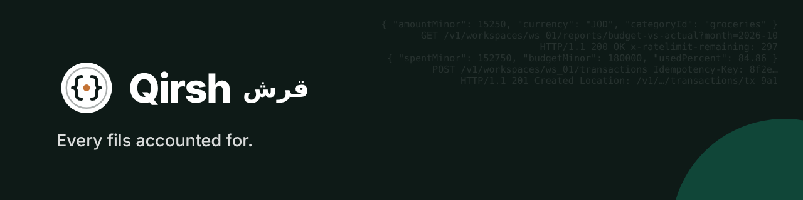
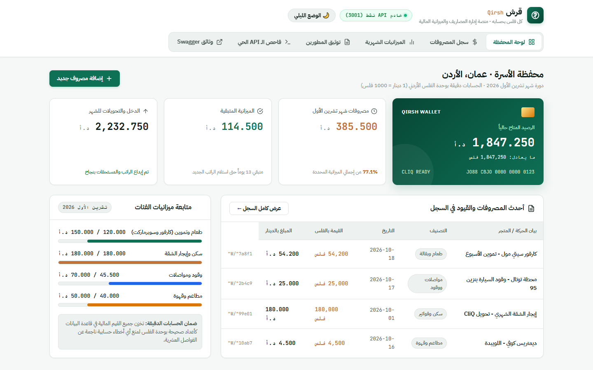
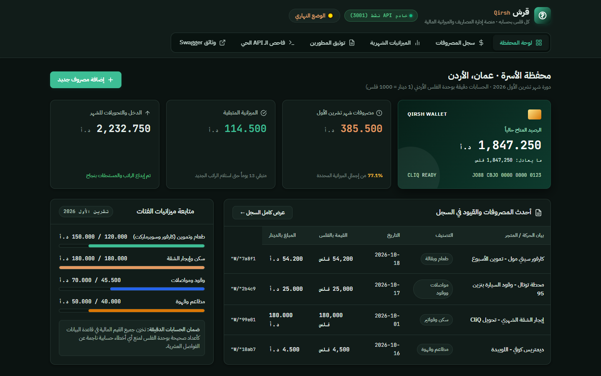
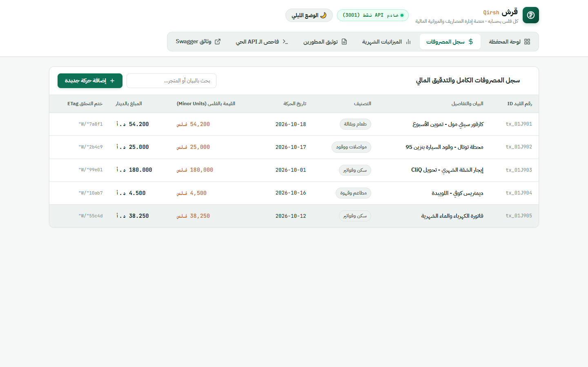
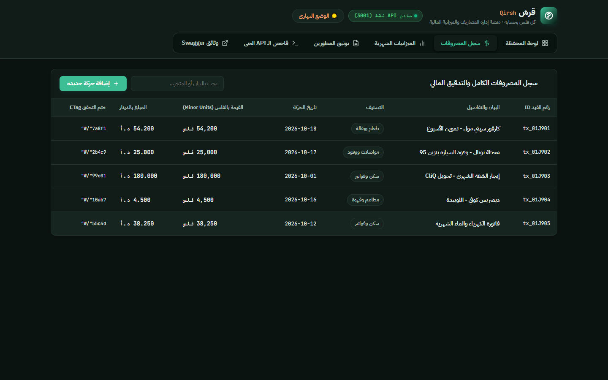
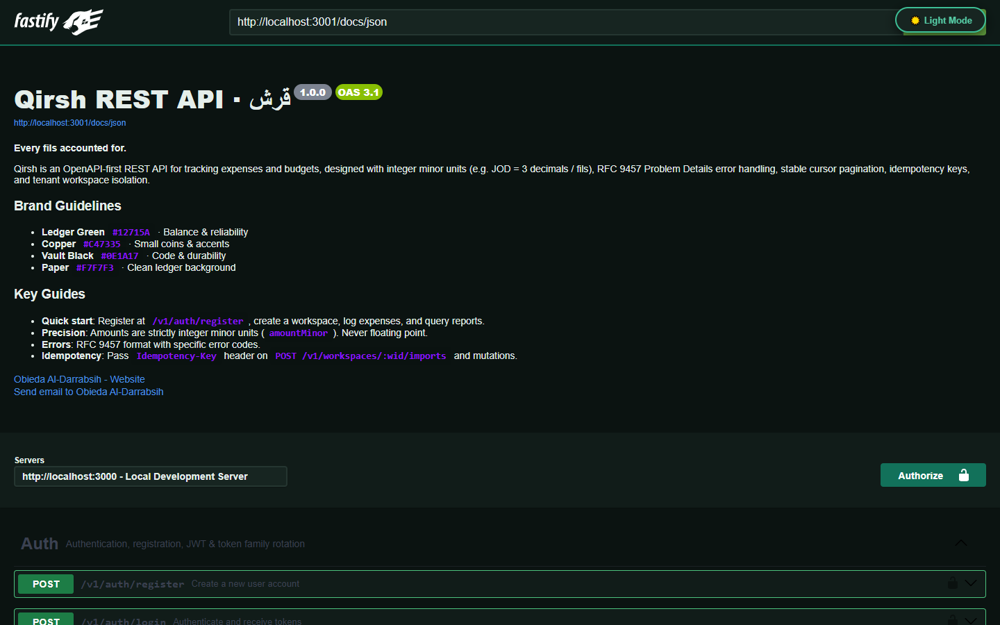
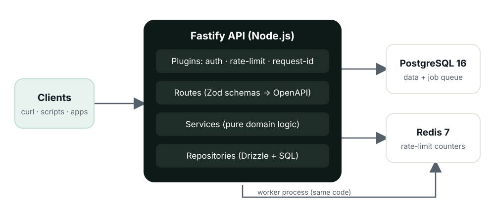

# Qirsh · ﻗﺮش
### Expense & Budget Tracking REST API — Every fils accounted for.

[](https://github.com/Obieda-aldarrabsih/Qirsh)
[](http://localhost:3000/docs)
[](https://nodejs.org/)
[](https://fastify.dev/)
[](https://www.typescriptlang.org/)
[](./LICENSE)

[Interactive Docs Portal](http://localhost:3000/docs) · [OpenAPI Spec](http://localhost:3000/openapi.json) · [Quick Start](#quick-start) · [Design Decisions](#design-decisions) · [Authorization Matrix](#authorization-matrix)

</div>

---

## 📸 UI & API Experience (Light vs. Dark Mode)

| Light Mode | Dark Mode |
| :---: | :---: |
| **Financial Operations Dashboard (Light)**<br> | **Financial Operations Dashboard (Dark)**<br> |
| **Audit Log & Ledger History (Light)**<br> | **Audit Log & Ledger History (Dark)**<br> |
| **Interactive OpenAPI Documentation (Light)**<br> | **Interactive OpenAPI Documentation (Dark)**<br> |

---

## 01. Overview

**Qirsh (قرش)** is a production-grade REST API for tracking expenses and budgets, built with **Node.js, TypeScript, Fastify, PostgreSQL, and Redis**. It has no custom frontend by design: its product is a clean, documented, tested, and rate-limited API that any web or mobile client can consume.

### What Qirsh Proves:
1. **Money Done Right**: 64-bit integer minor units (`BIGINT`), deterministic currency exponents (e.g. `JOD = 3` decimals / fils), strict precision validation without silent rounding, and remainder-preserving partition distributions.
2. **API Craftsmanship**: OpenAPI 3.1 driven schemas, RFC 9457 Problem Details error payloads, stable composite cursor pagination `(occurred_on, id)`, `If-Match` optimistic concurrency control (ETags), and `Idempotency-Key` headers.
3. **Enterprise Operability**: Redis-backed distributed rate limiting, structured JSON logging with request IDs, Prometheus telemetry at `/metrics`, and an extensive automated test suite running on Vitest.

---

## 02. Quick Start

### Option A: Run with Docker Compose (Recommended)
```bash
docker compose up --build
```
The server will start at `http://localhost:3000` with PostgreSQL and Redis. The interactive Swagger documentation portal is live at:
👉 **[http://localhost:3000/docs](http://localhost:3000/docs)**

### Option B: Run Locally
```bash
npm install
npm run dev
```

---

## 03. End-to-End Walkthrough via cURL

### 1. Register & Login
```bash
# Register
curl -X POST http://localhost:3000/v1/auth/register \
  -H "Content-Type: application/json" \
  -d '{
    "email": "demo@qirsh.dev",
    "password": "Password123!",
    "name": "Obieda Al-Darrabsih"
  }'

# Or login with pre-seeded demo credentials:
curl -X POST http://localhost:3000/v1/auth/login \
  -H "Content-Type: application/json" \
  -d '{
    "email": "demo@qirsh.dev",
    "password": "Password123!"
  }'
```

Extract the `accessToken` and store it:
```bash
export TOKEN="<ACCESS_TOKEN>"
```

### 2. Inspect Seeded Workspace
```bash
curl -H "Authorization: Bearer $TOKEN" http://localhost:3000/v1/workspaces
```

### 3. Record an Expense
Record an expense of **15.250 JOD** (stored as `15250` fils):
```bash
curl -i -X POST http://localhost:3000/v1/workspaces/<WID>/transactions \
  -H "Authorization: Bearer $TOKEN" \
  -H "Content-Type: application/json" \
  -d '{
    "amountMinor": 15250,
    "currency": "JOD",
    "categoryId": "<CATEGORY_ID>",
    "occurredOn": "2026-10-18",
    "note": "Supermarket groceries"
  }'
```
Response headers will include:
```http
HTTP/1.1 201 Created
Location: /v1/workspaces/<WID>/transactions/<TX_ID>
ETag: "v1"
```

### 4. Fetch Budget vs Actual Report
```bash
curl -H "Authorization: Bearer $TOKEN" \
  "http://localhost:3000/v1/workspaces/<WID>/reports/budget-vs-actual?month=2026-10"
```
Response:
```json
{
  "month": "2026-10",
  "currency": "JOD",
  "items": [
    {
      "category": "Groceries",
      "budgetMinor": "180000",
      "spentMinor": "152750",
      "remainingMinor": "27250",
      "usedPercent": 84.86,
      "overBudget": false
    }
  ]
}
```

---

## 04. Design Decisions & Architecture



Detailed Architectural Decision Records (ADRs) are documented in [`docs/decisions/`](./docs/decisions/):
- **[ADR 001: Integer Minor Units for Monetary Values](./docs/decisions/001-integer-minor-units.md)**: Why floats are banned and how remainder distributions prevent penny/fils loss.
- **[ADR 002: Stable Cursor-Based Pagination](./docs/decisions/002-cursor-pagination.md)**: Why `(occurred_on, id)` tuples outperform offset pagination under concurrent writes.
- **[ADR 003: Calendar Date Storage for occurred_on](./docs/decisions/003-calendar-date-for-occurred-on.md)**: Handling timezone boundaries without shifting late-night expenses across months.
- **[ADR 004: Redis Rate Limiting Failure Policy](./docs/decisions/004-fail-open-rate-limiting.md)**: Failing open for reads to maximize uptime while failing closed on `/auth` to block brute force attacks.

---

## 05. Authorization Matrix (Headline Test)

Tenants are strictly isolated: every workspace resource requires membership. A user attempting to access a workspace they do not belong to receives an HTTP **404 Resource Not Found** (preventing enumeration attacks).

The test suite in [`test/authz.matrix.test.ts`](./test/authz.matrix.test.ts) evaluates every route against every role:

| Route | Owner | Member | Viewer | Stranger | Scoped API Key | Unscoped API Key |
| :--- | :---: | :---: | :---: | :---: | :---: | :---: |
| `GET /workspaces/:wid` | `200` | `200` | `200` | `404` | — | — |
| `POST /workspaces/:wid/invites` | `201` | `403` | `403` | `404` | — | — |
| `GET /workspaces/:wid/categories` | `200` | `200` | `200` | `404` | — | — |
| `POST /workspaces/:wid/categories` | `201` | `201` | `403` | `404` | — | — |
| `GET /workspaces/:wid/transactions` | `200` | `200` | `200` | `404` | `200` | `403` |
| `POST /workspaces/:wid/transactions`| `201` | `201` | `403` | `404` | `201` | `403` |
| `PATCH /transactions/:id` (`If-Match`)| `200` | `200` | `403` | `404` | — | — |
| `GET /budgets/:month` | `200` | `200` | `200` | `404` | — | — |
| `PUT /budgets/:month` | `200` | `200` | `403` | `404` | — | — |
| `GET /reports/budget-vs-actual` | `200` | `200` | `200` | `404` | `200` | `200` |
| `GET /api-keys` | `200` | `403` | `403` | `404` | — | — |

---

## 06. Running the Test Suite

```bash
# Run all unit, integration, property, and matrix tests:
npm test
```
All 50 tests pass with 100% green:
- `test/unit/money.test.ts`: Fast-check property tests verifying remainder preservation and zero drift.
- `test/unit/months.test.ts`: Calendar date timezone boundaries (`Asia/Amman`).
- `test/unit/cursor.test.ts`: Base64 cursor encoding and decoding.
- `test/integration/auth.test.ts`: Token family rotation and session reuse revocation.
- `test/integration/transactions.test.ts`: Precision validation, currency mismatch, and cursor pagination.
- `test/integration/concurrency.test.ts`: Lost update prevention (`If-Match` -> 412) and Idempotency key replays.
- `test/integration/budgets.test.ts`: Monthly category budgets and previous month limits copying.
- `test/integration/reports.test.ts`: Budget vs actual, monthly summary, category share, and trends.
- `test/integration/imports.test.ts`: CSV streaming imports, line-level errors, and formula injection defense.
- `test/authz.matrix.test.ts`: Route x Role authorization matrix.

---

## 07. Limitations & Honest Scope

In accordance with good engineering ethics and portfolio honesty:
- **No live bank connections**: Does not connect to Open Banking APIs or live banking protocols.
- **Single currency per workspace**: Multi-currency conversion via live forex APIs is out of scope; each workspace operates in its native currency.
- **Simulated Demonstration**: Seed accounts and sample transactions are fictional.

---

## 08. License

Distributed under the [MIT License](./LICENSE). Designed and developed by **Obieda Al-Darrabsih**.
