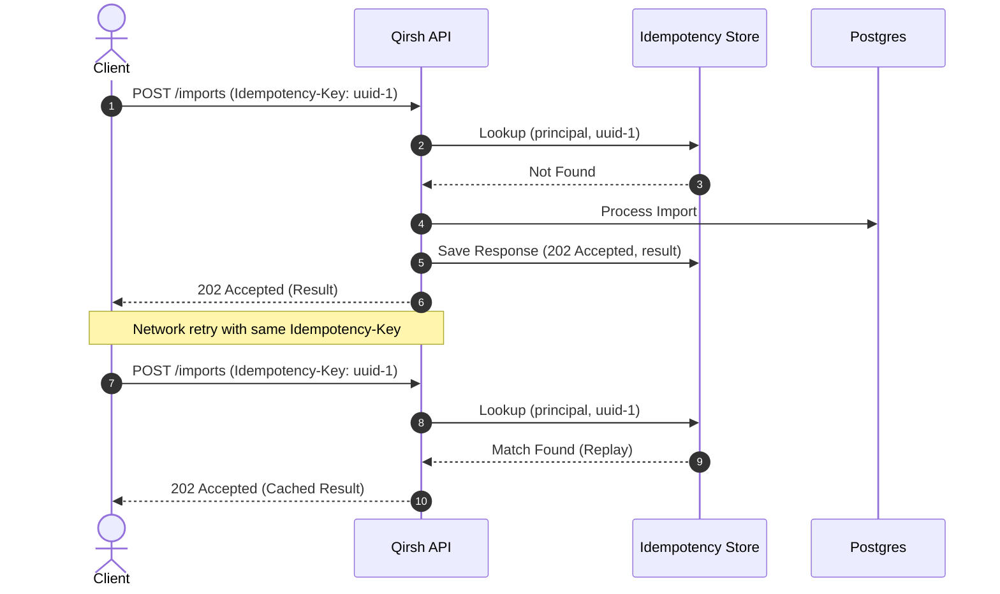

# Idempotency Guide

Network retries and mobile connections can cause clients to send duplicate requests. Qirsh supports safe retries via the `Idempotency-Key` HTTP header.

## How It Works
1. When submitting mutations such as `POST /v1/workspaces/:wid/imports` or bulk operations, provide an `Idempotency-Key` header with a unique identifier (UUIDv4 recommended):
   ```http
   Idempotency-Key: 9b1deb4d-3b7d-4bad-9bdd-2b0d7b3dcb6d
   ```
2. The server computes a SHA-256 hash of the request payload and checks for existing executions:
   - **First Execution**: The server processes the request and persists the resulting response and status code for 24 hours.
   - **Replay with Same Payload**: The server returns the cached response with header `X-Cache-Lookup: HIT-IDEMPOTENT` without re-executing the operation.
   - **Reused Key with Different Payload**: The server rejects the request with HTTP 422 `IDEMPOTENCY_KEY_REUSED` to prevent accidental overwrites or corrupted intent.


